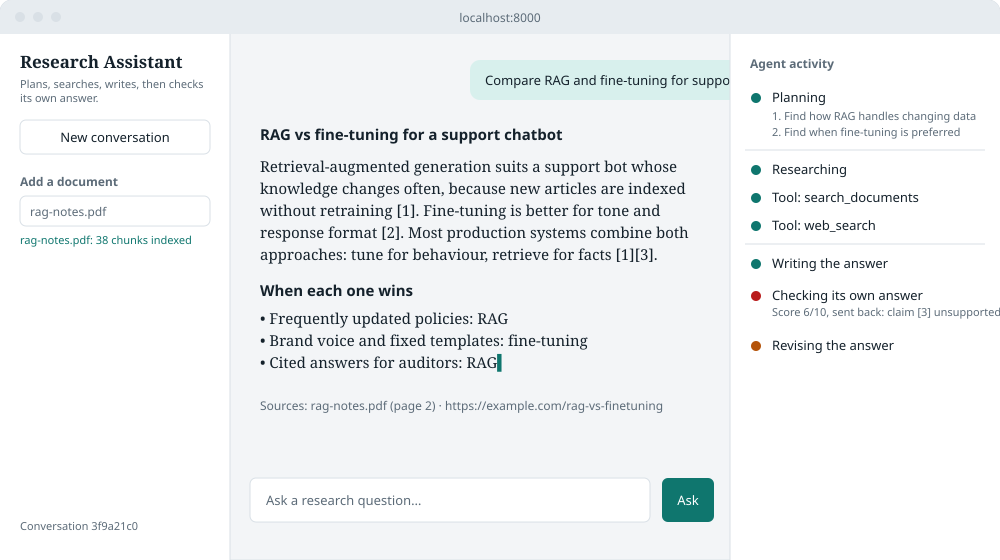
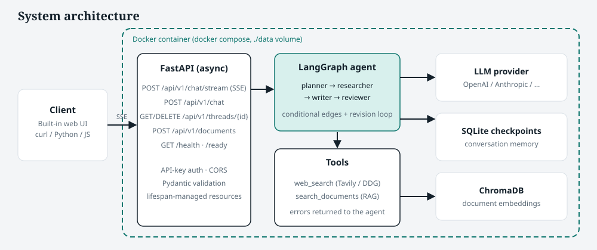
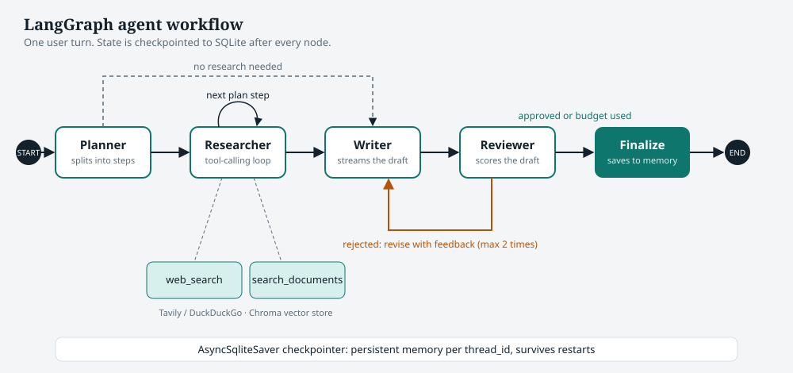
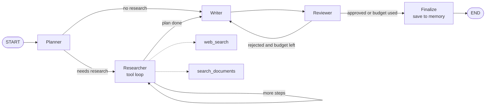

# Agentic AI Research Assistant

A multi-step **LangGraph** agent that **plans** a task, **calls tools** (web search and document retrieval), **writes** an answer, and **reviews its own output** before replying. It is served through **async FastAPI** endpoints with **streaming (SSE)** responses and **persistent memory**, and ships as a **Docker** container.

[](https://github.com/<your-username>/agentic-research-assistant/actions)




> The image above is a design preview. After your first run, replace it with a real screenshot saved as `docs/images/ui-screenshot.png`.

## Features

- **Plan → Research → Write → Review loop.** A planner splits the question into steps, a researcher runs each step with tools, a writer drafts, and a reviewer scores the draft. Rejected drafts are revised with the reviewer's feedback (bounded number of revisions).
- **Two tools.** `web_search` (Tavily if a key is set, otherwise DuckDuckGo with no key) and `search_documents` (RAG over your uploaded PDF, Markdown and text files, stored in ChromaDB).
- **Streaming API.** Server-Sent Events show planning, tool calls, review verdicts and the answer token by token.
- **Persistent memory.** Every graph step is checkpointed to SQLite by `thread_id`, so conversations survive restarts.
- **Production touches.** Optional API-key auth, CORS, Pydantic validation, structured logging, health and readiness probes, upload size and type limits, non-root Docker image with healthcheck, CI pipeline, and tests.
- **Provider-agnostic LLM.** Switch between OpenAI, Anthropic and others with two environment variables.

## Architecture



## Agent workflow





| Node | What it does |
|------|--------------|
| `planner` | Uses structured output (`Plan`) to decide if research is needed and to split it into short steps. |
| `researcher` | Runs one plan step with a bounded tool-calling loop. Tool errors are returned to the model instead of crashing the run. Collects source URLs and file names. |
| `writer` | Writes a cited Markdown answer from the findings. On a revision it also receives the reviewer's issues and the previous draft. |
| `reviewer` | Structured critique (`Review`): approved flag, 1 to 10 score, issues, feedback. A draft passes only if approved and the score meets `MIN_REVIEW_SCORE`. |
| `finalize` | Appends the accepted answer to the conversation messages so memory persists. |

## Project structure

```
agentic-research-assistant/
├── app/
│   ├── main.py                  # FastAPI app, lifespan (SQLite checkpointer + graph)
│   ├── config.py                # Typed settings from env / .env
│   ├── schemas.py               # Request / response models
│   ├── utils.py
│   ├── logging_config.py
│   ├── agent/
│   │   ├── graph.py             # Graph wiring and routing functions
│   │   ├── nodes.py             # planner, researcher, writer, reviewer, finalize
│   │   ├── state.py             # AgentState + Plan / Review schemas
│   │   ├── prompts.py
│   │   ├── llm.py               # Provider-agnostic chat model factory
│   │   └── runner.py            # run_once() and SSE event streaming
│   ├── tools/
│   │   ├── web_search.py
│   │   └── document_search.py
│   ├── retrieval/
│   │   ├── vector_store.py      # Chroma + embeddings
│   │   └── ingest.py            # load, chunk, index
│   ├── api/
│   │   ├── deps.py              # API-key auth, graph dependency
│   │   └── routes/              # chat, threads, documents, health
│   └── static/index.html        # Minimal streaming chat UI
├── scripts/ingest.py            # Bulk-index data/docs
├── tests/                       # Routing, graph, utils and API tests
├── data/docs/sample.md          # Sample knowledge-base document
├── docs/                        # Diagrams and interview guide
├── .github/workflows/ci.yml     # Lint, test, Docker build
├── Dockerfile  docker-compose.yml  Makefile
├── requirements.txt  requirements-dev.txt  pyproject.toml
└── .env.example
```

## Quick start

### Option A: Docker

```bash
git clone https://github.com/<your-username>/agentic-research-assistant.git
cd agentic-research-assistant
cp .env.example .env          # add your OPENAI_API_KEY
docker compose up --build
```

Open <http://localhost:8000> for the UI or <http://localhost:8000/docs> for the interactive API docs. The `./data` folder is mounted as a volume, so memory, vectors and uploads persist.

### Option B: Local

```bash
python -m venv .venv && source .venv/bin/activate      # Windows: .venv\Scripts\activate
make install                                           # or: pip install -r requirements.txt -r requirements-dev.txt
cp .env.example .env                                   # add your OPENAI_API_KEY
python -m scripts.ingest                               # optional: index data/docs
make run
```

## API

| Method | Endpoint | Purpose |
|--------|----------|---------|
| `POST` | `/api/v1/chat/stream` | Ask a question, receive an SSE stream |
| `POST` | `/api/v1/chat` | Ask a question, receive one JSON response |
| `GET` | `/api/v1/threads/{thread_id}` | Read a conversation's history |
| `DELETE` | `/api/v1/threads/{thread_id}` | Forget a conversation |
| `POST` | `/api/v1/documents` | Upload and index a PDF, `.md` or `.txt` file |
| `GET` | `/api/v1/documents` | List uploaded files |
| `GET` | `/health`, `/ready` | Liveness and readiness probes |

If `API_KEY` is set, send it as the `X-API-Key` header.

```bash
# Streaming (note -N to disable curl buffering)
curl -N -X POST http://localhost:8000/api/v1/chat/stream \
  -H "Content-Type: application/json" \
  -d '{"message": "Compare RAG and fine-tuning for a support chatbot", "thread_id": "demo-1"}'

# Follow-up that relies on memory (same thread_id)
curl -X POST http://localhost:8000/api/v1/chat \
  -H "Content-Type: application/json" \
  -d '{"message": "Summarise that in two sentences", "thread_id": "demo-1"}'

# Upload a document for retrieval
curl -X POST http://localhost:8000/api/v1/documents -F "file=@notes.pdf"
```

**SSE events**

| Event | Data |
|-------|------|
| `start` | `{thread_id}` |
| `node_start` | `{node}` for `planner`, `researcher`, `writer`, `reviewer`, `finalize` |
| `plan` | `{steps: [...]}` |
| `tool_start` / `tool_end` | tool name, input, output preview |
| `token` | `{text}` streamed from the writer (a new `node_start: writer` means a revision began, so clear the draft) |
| `review` | `{approved, score, issues, feedback}` |
| `final` | `{answer, plan, sources, review, drafts}` |
| `done` / `error` | end of stream / failure message |

## Configuration

All settings come from environment variables (see `.env.example`).

| Variable | Default | Description |
|----------|---------|-------------|
| `LLM_PROVIDER` / `LLM_MODEL` | `openai` / `gpt-4o-mini` | Any provider supported by LangChain `init_chat_model` |
| `EMBEDDING_PROVIDER` | `openai` | `openai`, or `fake` for offline tests |
| `TAVILY_API_KEY` | empty | If set, Tavily is used; otherwise DuckDuckGo |
| `MAX_PLAN_STEPS` | `4` | Upper bound on research steps |
| `MAX_TOOL_ROUNDS` | `3` | Tool-call rounds per step |
| `MAX_REVISIONS` | `2` | Revisions after a rejected draft |
| `MIN_REVIEW_SCORE` | `7` | Minimum reviewer score to accept |
| `API_KEY` | empty | Enables `X-API-Key` authentication |

## Testing

```bash
make test     # pytest: routing logic, graph compilation, API, auth, upload
make lint     # ruff
```

The test suite runs without calling a real LLM. It checks routing decisions, that the graph compiles with the expected nodes, API behaviour, authentication and document upload (using fake embeddings).

## Design decisions

- **Bounded loops everywhere.** Plan steps, tool rounds and revisions all have caps, plus a graph `recursion_limit`, so a run cannot loop or spend tokens indefinitely.
- **Self-review as a graph cycle.** The reviewer is a separate node with structured output and a conditional edge back to the writer, which keeps critique explicit, testable and observable.
- **Memory split.** Chat `messages` persist per thread; per-turn working state (plan, findings, draft) is reset on every turn so old research never leaks into a new question.
- **Streaming from graph events.** `astream_events` provides node transitions, tool calls and writer tokens from one source, which the API maps to SSE.
- **Resilient tools.** Tool exceptions become tool messages, so the agent can recover instead of failing the request.

## Roadmap

- Rate limiting and per-user threads with real authentication
- Postgres checkpointer and a hosted vector DB for multi-replica deployments
- Evaluation harness (answer faithfulness and citation accuracy) and LangSmith tracing
- Hybrid search with a re-ranker

## License

MIT. See [LICENSE](LICENSE).
